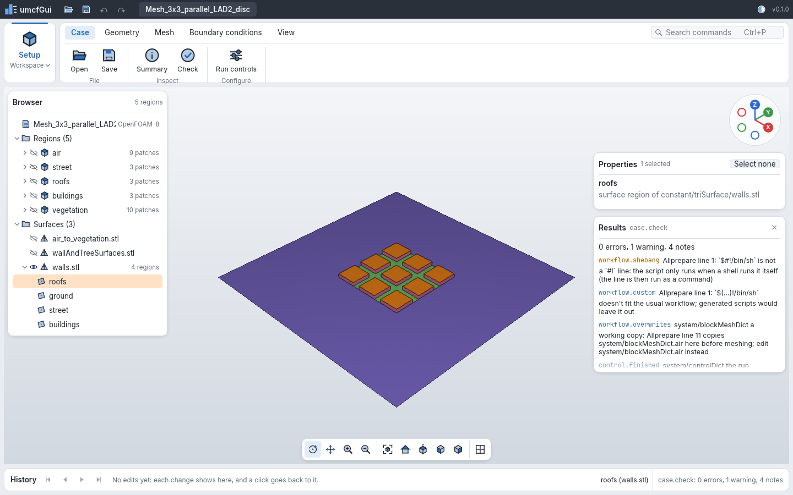
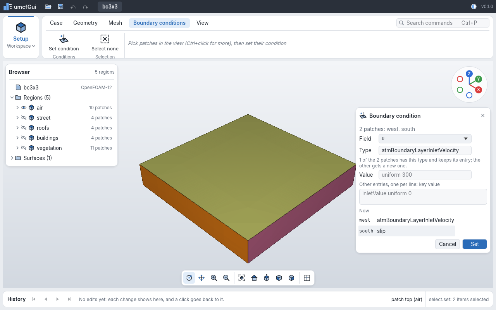

# The desktop app

`umcf-gui` shows a case in 3D and runs the same commands as `umcf-cli`: every change it makes to
the case is a command of the [registry](command-line.md#the-commands), so it is in the edit
history and can be undone, and a script can do the same. Selecting is a command too (in the
journal, not in the undo history); what the view shows, the camera and the theme are the
window's own.



```sh
umcf-gui path/to/case
umcf-gui path/to/case --show walls.stl --cmd 'select.set={"items": [{"surface": "walls.stl", "solid": "roofs"}]}'
umcf-gui path/to/case --size 1440x900 --screenshot shot.png
```

| Option | Does |
|---|---|
| `<case>` | Opens the case (`case.open`) |
| `--cmd '<id>=<json>'` | Runs a command once the case is open, as `umcf-cli run --cmd` does; repeat it for more |
| `--show <name>` | What the 3D view shows first: a mesh region or a surface (`walls.stl`); repeat it for more |
| `--open <id>` | Opens a command's card at the start, or runs it, as its ribbon button does (`--open bc.set`); a command that runs waits for the view's scene and the field files, when they were listed only. `--open cut` opens the [cut card](#a-cut-through-the-mesh) (where no case is open or no region has a mesh, `umcf-gui` stops with an error, as for a command that isn't there) |
| `--dark` | The dark theme |
| `--size <w>x<h>` | The window's size (default 1440x900) |
| `--renderer cpu\|gpu\|auto` | What draws the 3D view at the start. Without it: the CPU, with the window on a hardware GPU where there is one, so that the view can be switched to it. `gpu`, or `auto` (a hardware GPU where there is one): the GPU from the start. `cpu`: the window always on OpenGL, no switch (for a machine where a GPU window opens but can't show, as over `ssh -X`). A GPU window that doesn't open is opened again on OpenGL ([the GPU view](#the-gpu-view)) |
| `--screenshot <file.png>` | Writes a PNG of the window once it has drawn, then quits; fails without one when the case, a `--cmd` or a `--show` name does, or when the window gives no picture within half a minute |

## The window

- **The bar along the top**: open, save, undo and redo, the open case (`•` when it has unsaved
  changes), and the theme.
- **The workspace** (on the left of the ribbon): *Setup* holds what there is today. *Run* and
  *Results* are planned. Every workspace works on the same case and selection; only the ribbon
  changes.
- **The ribbon**: the commands in tabs and groups (Case, Geometry, Mesh, Boundary conditions,
  View). A command that can't run now is grey, and its tooltip says why. A command that needs
  parameters opens its card on the right: what it takes, and its parameters as JSON
  (`{"endTime": 7200}`); *OK* runs it. The checks, *Summary* and *Read fields* run at once.
  Commands without a place of their own are in a *More* group of their tab: *New case…* (its
  card starts with the air alone for OpenFOAM-12: [a new case](new-case.md)), *Add a region…*
  (a solid to name), *Read fields*,
  *Workflow description*, *Write workflow description*, *Describe a region*, *Describe a patch*,
  *Describe a material*, *Choose settings* (its card starts with the case's settings) and
  *Write the scripts* on *Case*, *Tree crowns* on *Geometry*.
- **Search commands** (Ctrl+P or F1): every command, filtered as you type; Enter runs the first
  that can run, or opens its card when it asks for parameters, as its ribbon button does.
- **The browser** (left): the case's regions and their patches (type and number of faces), and
  its STL surfaces and their regions. The eye says whether the 3D view shows a region or a
  surface. A click selects a patch or a surface region; Ctrl+click adds it or takes it out. A
  right click on a region, a patch, a surface or a surface region shows it as surfaces,
  wireframe or points, or hides it, and sets its opacity ([display modes](scene.md#display-modes)).
  A patch's menu has its patch groups too. What a region sets governs all its patches: its mode
  or opacity is taken off the patches and patch groups that had their own (a patch group's off
  its patches, a surface's off its regions), so that all of them are drawn as it is; a patch set
  after that keeps what it set until its region, or a patch group it is in, sets the same again
  (a patch in two groups takes its mode, and its opacity, from the group changed last that has
  one). The row notes what was set on it itself, when not the default (not what it takes from
  its region or groups; its menu shows how it is drawn), and *Reset* draws it as what it is part
  of again. What is hidden is not picked.
- **The 3D view**: the meshes' boundary patches or the surfaces, each patch in its own colour,
  the selection in orange (see [3D scene and selection](scene.md)). Drag to turn the view (or
  pan, with the navigation bar's *Pan*); a right or middle drag pans; the wheel zooms. A click
  selects what is under the cursor (`select.pick`), Ctrl+click toggles it, Shift+click adds it.
  The name of what is under the cursor shows in the history bar.
- **The axis triad** (top right): click an axis to look along it.
- **The view's guides and background**: a grid on the ground and the origin's planes and axes,
  over a dark background ([below](#the-grid-the-origin-and-the-dark-view)).
- **The navigation bar** (bottom): orbit, pan, *Box select* or *Brush*, zoom, fit, the standard views, the
  faces' edges, *Grid*, *Origin*, *Dark view*, *GPU* (where the window runs on a GPU device),
  *Pick faces* and *Select through*.
  - *Pick faces*: a click then picks the mesh face under it rather than its patch (Ctrl+click
    adds or takes away one, Shift+click adds one), drawn in the selection colour.
  - *Box select*: a drag draws a rectangle that selects what is in it (`select.rect`): the
    patches, or with *Pick faces* the mesh faces. Shift adds to the selection, Ctrl takes away.
    A click still picks, and a right or middle drag still pans.
  - *Brush*: a drag paints a stroke that selects what is seen under it (`select.brush`): with
    *Pick faces* the mesh faces, the way to mark out a new patch (*New patch*, below); else the
    patches. A click is a dab. Shift adds to the selection, Ctrl takes away; `[` and `]` make the
    brush smaller and larger (its outline follows the cursor). A stroke keeps 4096 points (one
    each third of the brush's radius moved): a longer one stops growing. A right or middle drag
    still pans.
  - *Select through*: the rectangle or the stroke takes everything in it, hidden too (the faces
    whose middle is in it), not only what is seen.
- **Properties** (right): the selected patches with their type, size and each field's boundary
  condition for them (by name or patch group; one given by a pattern is matched by the
  [case check](checks.md), not shown here), and the picked faces, counted by region.
- **Results** (right): the last command's message and its diagnostics, and for
  `workflow.show` and `workflow.import` the description (its problems and the import's notes
  first, then the settings and the regions); it opens when a command reports some.
- **History** (bottom): one chip per edit that can be undone, the marker after the last one
  done; a click on a chip undoes or redoes up to it. When there are more than fit, the ones
  nearest the marker are shown, with the number left out on each side.

*Open* (Ctrl+O) asks for the case's folder (the one holding `system/`, `constant/` and the time
directories) in the system's own dialog, over the app's window: the Windows file dialog, the
macOS open panel, and on Linux the desktop portal (`xdg-desktop-portal`, which GNOME, KDE and
most desktops run) or else `zenity`. A folder that doesn't open (not a case, or the open case
has unsaved changes) brings up the *Open* card with the path and why, to change it or to open
anyway (`"discard": true`). On a Linux system with neither dialog (a window manager without a
desktop, and no `zenity`) the card asks for the path instead; a desktop whose portal service isn't
running shows no dialog at all, so install `zenity` or `xdg-desktop-portal` there.
`umcf-gui <case>` opens a case from the command line on every system.

Shortcuts come from the commands: Ctrl+O open, Ctrl+S save, Ctrl+Z undo, Ctrl+Shift+Z redo, F7
check. Escape closes the parameter card, the condition card, the results and the search (not a card
whose command waits or runs: its outcome closes it).

## The grid, the origin and the dark view

The 3D view is dark (a flat dark grey), whatever the window's theme; turning *Dark view* off (in
the *View* tab's *Display* group and the navigation bar) makes it light. Over it:

- **The grid** lies on the ground, the plane z = 0, around where the view's axis meets it. Its
  lines are a step of 1, 2 or 5 times a power of ten apart, 10 to 25 of them over half the
  view's height, and every fifth is brighter; zooming changes the step. It fades out with the
  distance from the middle of the view. It lies under everything: the case hides it, it never
  hides the case, also where the case goes below z = 0. *Grid* turns it off.
- **The origin**: three small translucent squares on its xy, xz and yz planes (each on the
  positive side of its two axes), 7.5 % of the view's height, outlined, and the x, y and z axes
  (red, green, blue), solid to the squares' side and dashed beyond. What the case shows in front
  of them hides them; a square on a patch (the origin at a corner of the domain, say) is seen on
  it, unless the patch is selected (the selection is drawn nearer). A transparent layer behind a
  square is still seen through it. *Origin* turns them off.

Both are drawn the same by the GPU and the CPU, and in snapshots (`scene.snapshot`'s `grid`,
`origin` and `dark`, `umcf-cli render`'s `--no-grid`, `--no-origin` and `--light`; the
*Snapshot* card starts with them as the view has them switched). Like *Edges*, the switches are
settings of the window, not commands.

## A cut through the mesh

*Cut* (the *View* tab's *Inside* group) opens a card that cuts a region's mesh with a plane and
shows the cells it crosses, whole ([a cut](scene.md#a-cut-through-the-mesh)): the *Region* (with a
mesh; `air` first), across *x*, *y* or *z*, *At* a position along it (a slider over the region's
extent, also for a region turned off in the browser; it starts in the middle), and *Flip* for the
layer on the plane's other side where it lies on faces between cells. While the card is open the
region's boundary is hidden (its layer in the browser says so), as it would hide the cut; closing
the card takes the cut away and shows the boundary again. *Edges* draws the cells' edges. The first
cut of a region reads its whole mesh; moving the plane after reads nothing. Where no region has a
mesh, *Cut* is greyed out. With nothing turned on in the browser, the cut shows on its own.
`umcf-gui <case> --open cut` opens the card at the start.

## The GPU view

The 3D view is drawn by the CPU, or on the GPU. Where the machine has a hardware GPU, the app's
window runs on it and the view starts on the CPU; *GPU* in the *View* tab's *Display* group and
in the navigation bar switches between the two at any time, and so does a
click on *GPU* or *CPU* at the right of the history bar. The label says which drew the view, its
tooltip why the CPU did when the GPU was asked for; the click switches the setting, as *GPU*
does (with the GPU on and a frame the CPU drew, *CPU* in amber, it turns the GPU view off).
Without a GPU view the label is only shown, not a switch. Like *Edges*, the switch is a setting
of the window, not a command: the command line's `scene.snapshot` and `umcf-cli render` always
draw on the CPU.

- **When there is a GPU view.** At the start the app looks for a GPU device it can draw on
  (Vulkan, Metal or Direct3D 12, or OpenGL with storage buffers in vertex shaders, through
  wgpu), and the whole window runs on it. A software one (no faster than the CPU) and a virtual
  machine's are passed over unless `--renderer gpu` asks for them. Without one, and with
  `--renderer cpu`, the window runs on OpenGL and the view is drawn by the CPU: *GPU* is grey
  in the ribbon, its tooltip saying why, and left out of the navigation bar. `--renderer gpu`
  or `auto` start the view on the GPU. A GPU window that doesn't open is opened again on OpenGL
  (the tooltip says why). One that opens but can't show, as over `ssh -X` to a machine with a
  GPU, may fail or stop the app: start it there with `--renderer cpu`.
- **When the GPU fails** (out of its memory, a limit of the device), the view goes back to the CPU
  for the rest of the session and the tooltip says why.
- **What it draws.** The same picture as the CPU: each patch or surface region in its colour,
  shaded per triangle with the light at the eye, outlines where patches meet, the selection in
  orange in front of what lies in the same place, what is hidden left out. *Edges* darkens the
  faces' edges; wireframes and points go over the surfaces where nothing opaque is in front,
  blended with their opacity, a selected face's in orange. Where surfaces of two regions lie in
  the same place, the region listed first is seen, as on the CPU (where the CPU's depths round
  otherwise, it can show a few of the other region's face edges through it, with *Edges* on; the
  GPU doesn't). An opaque selection is seen over opaque surfaces within 1e-5 of its distance in
  front of it, as on the CPU; on OpenGL, whose depths are less precise, within 1e-4 (a selected
  opaque patch a millimetre behind another, ten metres away, shows through there). A
  transparent layer in front of an opaque selection is held to 1e-5, on OpenGL too, and a
  selected transparent layer has no margin. Wireframes and points are seen where no surface is
  in front, whether it is selected or not, as on the CPU; only where a later region's surface
  lies a hair in front of an earlier one's (within the margin that puts the earlier in front)
  are the earlier region's wireframes and points seen through it. Lines one pixel wide can take
  a neighbouring pixel here and there.
- **Transparent layers** are blended over the rest (and over the wireframes and points behind
  them, as on the CPU), seen where nothing opaque is in front, a selected face's or patch's in
  orange. The nearest layer on each pixel is found first (two passes of their own; of layers
  within 1e-4 of the distance of the nearest, as two regions' faces on their interface, the
  first region's) and blended last,
  over the others, as on the CPU, with its outlines as much as it covers what is behind it: at
  an opacity near 1 a layer looks as it does opaque, and turning the opacity down from 1 is
  smooth. Behind it, where layers of different colours lie over each other, the GPU doesn't
  sort them: it mixes them, the nearer counting more (weighted, blended transparency), where the
  CPU blends the farthest first. The colours there can differ from the CPU's, more the more of
  them there are; the nearest is the same. The GPU's blend doesn't depend on the order the
  triangles are drawn in (each triangle is still shaded by its own middle, as on the CPU).
- **What the CPU still draws.** On a device that can't blend half-float images (some OpenGL
  ES drivers), transparent layers bring the CPU view back (the history bar says so). Picking,
  *Box select*, the *Brush* and `scene.snapshot` work on the CPU either way, on the same scene.
- **How fast.** The Hong Kong project's five regions (15 million triangles) at 1440 × 860:
  turning, panning and zooming take 3 to 8 ms a frame on an NVIDIA RTX 5060 Ti, against about a
  second on the CPU (which draws at half the resolution while the view moves). The first frame
  uploads the meshes (0.23 s); what the view shows stays on the GPU until it is hidden or read
  again. A new selection of patches or a display mode uploads only colours; picked faces upload
  their triangles. Edges cost nothing more (3.5 ms a frame). The first wireframe or points layer
  of a region finds its edges and points and uploads them (3.5 s for all five regions, as the CPU
  takes on its first frame of them); with every region a third surfaces, a third wireframe and a
  third points, with edges, a frame takes 8.4 ms, against 1.25 s on the CPU. With a third of
  every region's patches transparent, 5.8 ms, against 2.2 s on the CPU (measured before the
  nearest layer's two passes, which draw the transparent layers twice more). The transparent layers
  take three half-float images and four of 32-bit words of the view's size (34 bytes a pixel).

## Long work

Long work runs beside the window, which stays in use: you can turn the 3D view, browse the case,
open cards and look at the results while it runs. The status bar shows what runs, how far it is
and *Cancel*, with a bar that fills where the job can tell how far it is:

- reading the field files: as the files are done ("21 of 30");
- reading what the 3D view shows: as the bytes of its meshes' and surfaces' files are read
  ("1.0 of 1.4 GB read"), and the regions and surfaces read and drawn;
- the mesh check (*Check mesh*): as the bytes of the mesh files are read and the faces are
  checked.

Other work shows the megabytes read so far; all work shows the seconds it has run. This holds
for the ribbon's commands, a command card's *OK*, the *Set* of the boundary condition, patch and
new patch cards, going back or forward in the history bar, reading the field files, and reading
the meshes and surfaces the 3D view shows.

What you ask for while a job runs waits, and runs after it, in order: a command, a card's *Set*
(the card shows its values as sent, *Setting…*, and closes when the command worked or shows the
error; it acts on the patches or faces the card shows, whatever is selected by the time it
runs), a pick in the view, an undo. The status bar says how much waits. A reading of the 3D view
not started yet gives way to other work and follows it.

Work that only reads (the checks, the summary, reading the fields or what the view shows) has
*Cancel*: the case's files are read no more, the work stops, and the case is as it was. Work
that changes the case (an edit, an undo) runs to its end.

Opening and saving a case take the whole window from the moment they are asked for (behind a
job, too): what it would show is the case before, and what was asked meanwhile would act on the
case opened. Opening has *Cancel* (the case open stays); a save runs to its end, and the window
doesn't close before it has.

A case opens quickly, with its field files listed only: the meshes and surfaces the view shows
are read first, so the case shows at once, then the field files, as a job of their own. Until
they are read, their boundary conditions aren't known (a check says so: `fields.pending`), and
conditions and patches can't be changed (`bc.set`, `patch.set` and `patch.create` say to read
them first): the field files change with them. *Read fields* (`case.fields`, in the *Case* tab's
*More* group or the search) reads them after a *Cancel*. A case named on the command line
(`umcf-gui <case>`) opens the same way; with `--cmd`, its fields are read as it opens, for the
commands to act on.

## Patches

*Edit patch* (on the *Mesh* and *Boundary conditions* tabs) opens a card for the selected
patches, filled from the first: the name (one patch at a time, with *In the results too, when
saved*), the type, typed or picked from the suggestions under it, the groups, other entries
(`neighbourRegion air`), and what each patch is now. *Set* sends only what was changed, as
[`patch.set`](meshes.md#editing-patches): a renamed patch stays selected, and its field files
follow (and, ticked, [its results](meshes.md#a-new-name-in-the-results) on *Save*).

*New patch* (on the *Mesh* tab) opens a card that prepares a patch, as
[`patch.create`](meshes.md#new-patches): the name, the type, the groups, and the faces: those
picked, selected in a rectangle or painted with the *Brush* in the view (chosen when faces are
picked), or, of the selected patches, those whose centre
is in a box (from x y z, to x y z) or within a distance of a surface of the case (one of its
solids, or all of it). *Prepare* writes the face set and adds the
patch to the dictionary of the patches prepared on this mesh; the mesh gets them when
`createPatch` runs once with that dictionary.

## Boundary conditions

Select the patches in the view or the browser (Ctrl+click adds one), then *Set condition* on the
*Boundary conditions* tab. The card shows:

- the **field**: the fields every selected patch's region has at the start time, `U`, `T`,
  `p_rgh`, `p` and the turbulence fields first;
- the **type**, typed or picked from the suggestions under it: OpenFOAM's common types and the
  solver's own for the field (scalar or vector) and the case's OpenFOAM version, from the
  [catalog](../solver-coverage.md). Any other type can be typed; the case check judges it;
- the **value** (`uniform 300`, `uniform (2 0 0)`), filled in from the first patch. Left as it
  is, it goes only to patches that get a new entry, and a patch keeping its entry keeps its own
  value; changed, it goes to every selected patch;
- other entries, one `key value` per line (`inletValue uniform 0`);
- what each patch has **now**, and whether the entries already there stay (the same type) or the
  patch gets a new entry.

*Set* runs [`bc.set`](fields.md#setting-boundary-conditions) for the selected patches. It is one
edit in the history, undone with Ctrl+Z, and the results card lists what the case check finds
about the new conditions.



## Limits

- The CPU view is drawn at the window's resolution (at half of it while the view turns); it
  keeps up with surfaces and meshes of a few hundred thousand boundary faces. The GPU holds what
  the view shows (about 16 bytes per triangle and 12 per point: 340 MB for the Hong Kong project;
  once a region was a wireframe or points, 12 bytes per edge and 8 per point more); while a
  region's points don't fit one of its buffers, the whole view is drawn by the CPU. A region's
  first wireframe or points layer is found on the window's thread, which waits for it (seconds
  for millions of faces, on either view).
- The 3D view reads regions at once and keeps hidden ones within a share of the memory free when
  the app starts (or `UMCF_MEMORY` in megabytes): see [memory](scene.md#memory). A hidden region
  dropped past it is read again when it is shown.
- A command's parameters are typed as JSON, apart from boundary conditions, which have a card
  of their own; forms for the others come with meshing.
- *Cancel* stops reading a mesh's ASCII `points` or `faces` and field files within a megabyte,
  but a file read whole (binary meshes, the mesh check's) only once it is read; the mesh check's
  computing stops within 65,536 faces, apart from the checks *all geometry* adds, which stop
  only at their end. The bar of the 3D view and of the mesh check follows
  the bytes of the files they expect to read, from the sizes on disk, and their steps; other
  work besides the field reading shows the megabytes it has read and the seconds it has run, not
  how far it is.
- The window reads the case's files when it needs them, not when they change. An STL copied
  into `constant/triSurface` shows in the browser after the next command; a file changed outside
  the window shows when the case is opened again. A scene that failed to build (a mesh not
  written yet) is read again by the next command or *Fit*.
